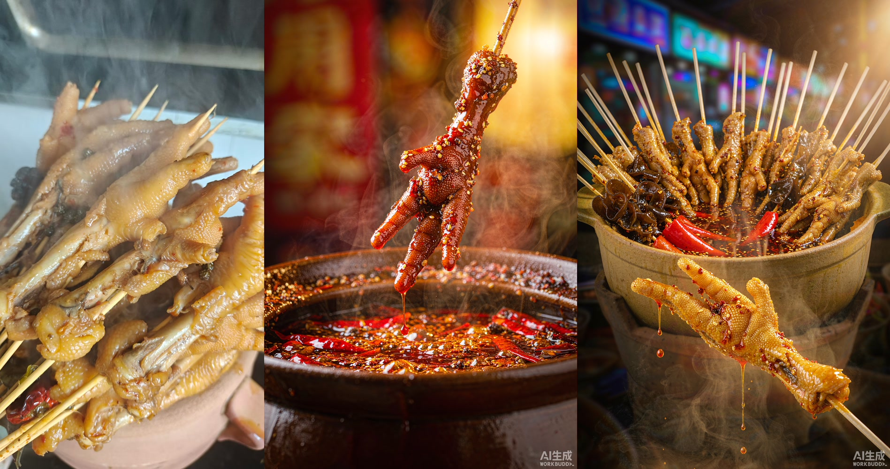

# 案例 01：鸡爪颜色与形态校准

## 问题与证据

原项目希望把真实瓦罐串串做成有夜市氛围的产品图。第一版有明显油光和热气，但鸡爪变成深红色，偏离了实拍的金黄褐色。

| 项 | 实拍可见 | v1 / v3 的变化 |
|---|---|---|
| 颜色 | 金黄褐色鸡爪 | v1 偏深红；v3 向金黄褐色修正 |
| 容器与陈列 | 陶罐、密集鸡爪与竹签 | v1 偏单只展示；v3 加回罐口陈列 |
| 构图 | 实拍斜俯视 | 生成版本重新组织构图，不能称为仅调色 |
| 剩余问题 | 真实连接关系 | v3 前景鸡爪显得悬浮，见案例 02 |

## 修改方式

原记录同时调整颜色、竹签、容器、视角和背景。v3 提示词写明“鸡爪卤成金黄褐色”“白色细木签”“土黄色陶瓦罐”。完整存档见 [历史提示词](historical-prompts.md)。

这不是严格单变量实验，不能把变化全归因于某一句提示词。v1 最终提交的完整提示词与模型参数没有在本包中得到核验，不把通用初稿冒充原始输入。

## 可以复用的经验

先列事实卡，再做风格；产品准确与画面好看分开检查。即使传入参考图，生成后仍逐项复核。没有真实参考时只能做概念探索。

状态：历史视觉探索案例，非商业效果验证。生产工具精确模型、种子及采样设置未记录。图片原有 AI 标记保留；来源见 [记录](../docs/provenance.md)。
