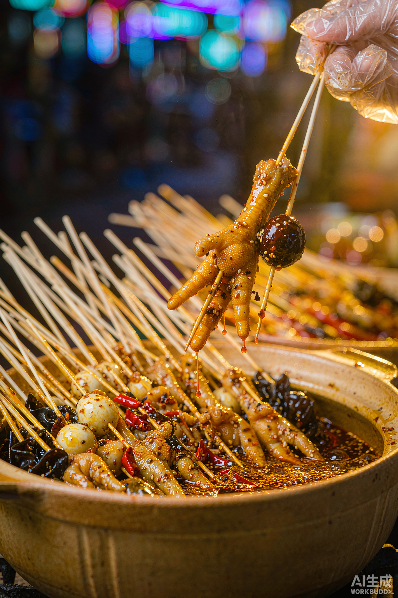

# 案例 02：从悬浮感到手持提串

v3 已接近实拍颜色，但前景鸡爪与画外支撑之间的关系不清楚。v4 加入右上方手持竹签的动作，明确“正从罐中提起”。

历史提示词中的核心变化：

> 手指捏着一根白色细木签的签尾，正把一只卤鸡爪从瓦罐里缓缓提起。

完整记录见 [历史提示词](historical-prompts.md)。同一版还调整了配料、构图等因素，不能作为“加手套必然解决问题”的证明。

## 本次观察

- 手、竹签和提起动作比 v3 更容易理解。
- 金黄光泽、背景灯斑和配料仍然明显风格化。
- 手部、竹签接触处和食材形态仍需检查，戴手套不保证模型正确，也不证明实际卫生状况。
- 原项目记录将 v4 选为定稿；本包把它定位为历史风格探索的选中版本，不等于真实产品事实全部通过。

## 改成通用修正方法

写清动作主体、工具接触、支撑方向和动作终点。若无法修好，可简化为罐口特写、使用真实提串照片，或保留产品区域后单独处理背景。不要为了消除悬浮感随意增加手、食物或改变数量。

状态：静态画面已复查，未重新生成、未做用户转化实验。模型版本与种子未记录。
