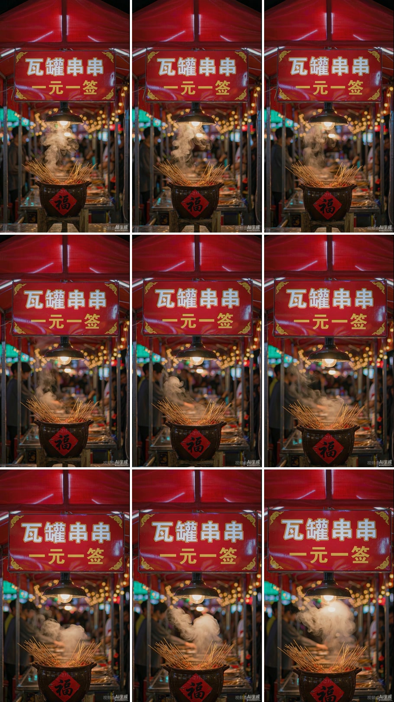

# 案例 03：招牌与食物镜头分工

原项目的 A11 是“招牌夜景点亮”镜头。画面可以交代品牌，但食物很小、竹签明显，难以展示产品细节。后续单独增加食物特写，不必把品牌镜头本身判为无用。

## 从画面得到的结论

- 招牌占据视觉重点，适合品牌识别或结尾定位。
- 食物细节较弱，不适合独立承担产品质感展示。
- 抽样帧能帮助发现明显文字漂移，但不能证明视频每一帧都通过。

原项目记录称曾做首尾帧与文字检查。本次只复查此九宫格，未重新核验视频全程，故不沿用“全程零变形”的结论。

## 可复用做法

用镜头表分配用途：环境交代位置，过程交代动作，特写展示食物，信息收尾呈现品牌。精确文字优先后期排版；生成招牌也必须逐字校对。

图中的店名与口号是该案例的历史内容，不是其他摊位的默认信息，也不能从口号推断所有菜品的真实售价。复用时按用户确认的品牌和价格重新填写。

原镜头运动提示词的可确认片段见 [历史提示词](historical-prompts.md)。本包未收录完整视频、音轨或未经核验的完整生成设置。
